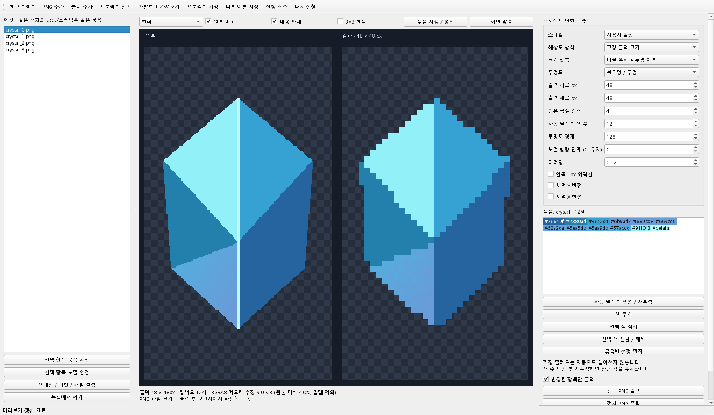
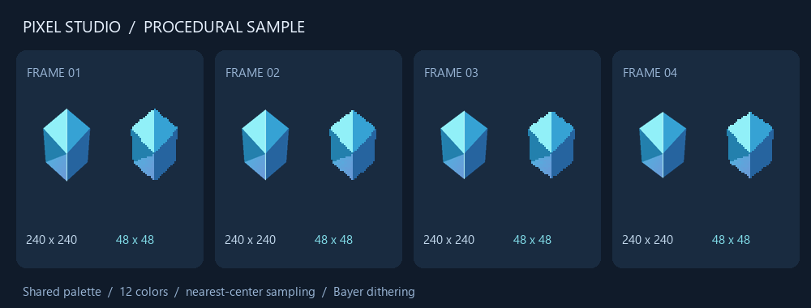
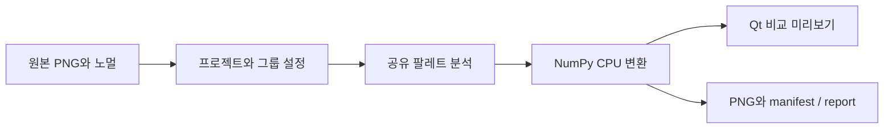

# Pixel Studio

[](https://github.com/minjiyong/Pixel-Studio/actions/workflows/checks.yml)

**PNG 에셋을 묶음으로 도트화하고, 팔레트·투명도·노멀맵을 함께 관리하는 Windows 데스크톱 도구입니다.**

하르벤 제작 도구에서 Python 부분을 분리했습니다. Godot이나 하르벤 서버 없이 실행할 수 있으며, GUI와 명령행 일괄 출력을 모두 제공합니다.

`Python 3.12` · `PySide6` · `NumPy` · `Pillow` · `PyInstaller`



## 주요 기능

- PNG·폴더·카탈로그 가져오기, 방향·프레임별 에셋 그룹 관리
- 고정 출력 크기 또는 원본 픽셀 간격으로 변환
- 그룹 공유 팔레트 생성, 색 편집·잠금·스포이트
- Bayer 디더링, 외곽선, 이진 투명도·반투명 보존
- 노멀맵 단계화·축 반전과 조명 미리보기
- 원본·결과 비교, 프레임 재생, 타일 반복 보기
- 프로젝트 저장, 실행 취소·다시 실행
- 증분 일괄 출력, 취소·재시도, 결과 manifest와 보고서 생성

## 실행

```powershell
git clone https://github.com/minjiyong/Pixel-Studio.git
cd Pixel-Studio
python -m pip install -r tools/pixel_studio/requirements.txt
python -m tools.pixel_studio
```

Windows에서는 `Start-Pixel-Studio.cmd`를 실행해도 됩니다. 빌드된 배포본이 있으면 배포본을, 없으면 Python 소스를 실행합니다.

처음 확인할 때는 **프로젝트 열기 → `examples/demo.pixel.json`**을 선택하세요. 예제 이미지는 이 저장소를 위해 수식으로 생성한 샘플이며, 하르벤의 외부 에셋 원본을 포함하지 않습니다.



## 명령행 일괄 출력

```powershell
python -m tools.pixel_studio --project examples/demo.pixel.json --export out/demo
# 특정 에셋만 출력
python -m tools.pixel_studio --project examples/demo.pixel.json --export out/demo --ids crystal_0
```

출력 폴더에는 PNG, `pixel-manifest.json`, `pixel-report.json`이 만들어집니다. 원본 PNG는 덮어쓰지 않습니다. 명령행 출력은 팔레트 등의 분석 결과를 프로젝트 JSON에 저장하므로, 기본 제공 예제를 유지하려면 복사본으로 실행하세요.

## 구현 구조



| 파일 | 책임 |
|---|---|
| [core.py](tools/pixel_studio/core.py) | 설정 검증, 팔레트 생성, 이미지 변환, 노멀 처리, 증분 출력 |
| [app.py](tools/pixel_studio/app.py) | Qt 화면, 미리보기, 팔레트 편집, 작업 스레드, 프로젝트 조작 |
| [catalog.py](tools/pixel_studio/catalog.py) | 일반 카탈로그 및 하르벤 카탈로그 가져오기 |
| [__main__.py](tools/pixel_studio/__main__.py) | GUI·CLI 진입점 |
| [test_core.py](tools/pixel_studio/test_core.py), [test_ui.py](tools/pixel_studio/test_ui.py) | 변환·출력과 UI 회귀 검사 |

변환 규약은 `pixel.asset.project` version 1 / `pixel-center-rgb709-v1`입니다. 픽셀 중심 최근접 표본, Rec.709 가중 sRGB 거리, 결정적인 팔레트 분할을 사용합니다. 노멀은 일반 색 팔레트로 양자화하지 않고 벡터로 처리합니다. 세부 조작은 [사용 가이드](tools/pixel_studio/README.md)에 있습니다.

## 테스트와 빌드

```powershell
python -m unittest tools.pixel_studio.test_core tools.pixel_studio.test_ui -v

python -m pip install pyinstaller
powershell -ExecutionPolicy Bypass -File tools/pixel_studio/build.ps1
```

빌드 결과는 `out/pixel-studio/PixelStudio/`에 생성됩니다. 배포할 때는 **EXE 하나가 아니라 해당 폴더 전체**를 전달해야 합니다. 실행 검증 결과는 [docs/VALIDATION.md](docs/VALIDATION.md)에 기록합니다.

## 범위와 제한

- PNG만 입출력합니다. 자동 도트화가 수작업 픽셀 아트의 형태 교정을 대신하지는 않습니다.
- 저장 시 프로젝트가 원본 파일의 절대경로를 기록합니다. 공유할 프로젝트는 상대경로를 사용하거나 다시 가져와야 합니다. 기본 제공 예제는 상대경로입니다.
- PNG 파일 크기 감소와 게임 엔진의 텍스처 메모리 감소는 서로 다릅니다.
- Godot 에디터의 GPU 미리보기 통합은 이 독립 Python 저장소에 포함하지 않았습니다.
- 대규모 배치 처리의 성능 수치를 새로 측정했다고 주장하지 않습니다.

[하르벤 클라이언트](https://github.com/minjiyong/HARVEN-CLIENT-Portfolio) · [공개 범위](docs/PUBLICATION.md) · [소스와 라이선스 안내](SOURCE_NOTICE.md)
